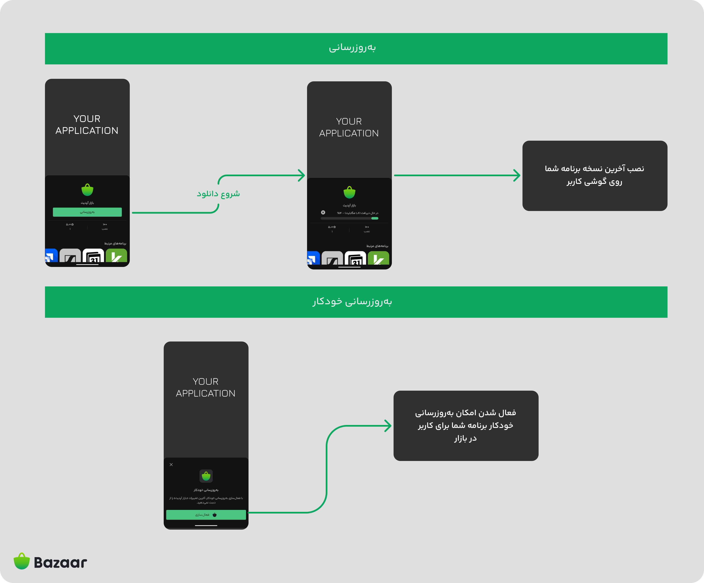

# BazaarUpdater Android SDK

<p align="center">

</p>

[](https://www.apache.org/licenses/LICENSE-2.0)
[](https://jitpack.io/#cafebazaar/BazaarUpdater)


BazaarUpdater is an Android library that simplifies checking for updates and managing the update process for your application on Bazaar.

## Setup

To get started with BazaarUpdater, you need to add the JitPack repository to your project and include the library dependency.

### Adding JitPack Repository

**Kotlin DSL**

```kotlin
repositories {
    maven { url = uri("https://jitpack.io") }
}
```

**groovy**
```groovy
repositories {
    maven { url 'https://jitpack.io' }
}
```

## Adding Dependency

**Kotlin DSL**

```kotlin
dependencies {
    implementation("com.github.cafebazaar:bazaarUpdater:1.2.1")
}
```

**groovy**

```groovy
dependencies {
    implementation 'com.github.cafebazaar:bazaarUpdater:1.2.1'
}
```
## Usage

### Updating the Application

To update your application when a new version is available on Bazaar, simply call:

```kotlin
BazaarUpdater.updateApplication(context = context)
```
## Auto Update

This feature allows you to enable automatic updates for your apps in Bazaar. Once enabled, Bazaar will check for application updates daily. If an update is available and Bazaar is the update owner of your app, it will automatically download and install the update.

> ⚠️ Note: This feature requires Bazaar version 26.2.0 or higher.

> ⚠️ Package Name : Ensure the package name (also known as the application ID in Android) in your source code exactly matches the one used in the already published app. This is typically defined in your app's AndroidManifest.xml file.

> ⚠️ Signature : The app must be signed with the same key as the published version. Make sure you’re using the correct keystore and alias that were used for the original app.

### Checking for Auto Update

To check whether Auto Update is enabled for your application in Bazaar, use the following code:

```kotlin
BazaarAutoUpdater.getLastAutoUpdateState(context = this) { result ->
    when (result.getState()) {
        AutoUpdateState.ENABLED -> {
            // Auto Update is active — nothing to do
        }
        AutoUpdateState.DISABLED -> {
            // Auto Update is supported but turned off — prompt the user to enable it
        }
        AutoUpdateState.NOT_SUPPORTED -> {
            // Bazaar is not installed or needs to be updated to version 26.2.0+
            val errorMessage = result.getError()?.message
        }
    }
}
```

<details>
<summary><strong>Java Usage</strong></summary>

```java
BazaarAutoUpdater.getLastAutoUpdateState(context, result -> {
    switch (result.getState()) {
        case ENABLED:
            // Auto Update is active — nothing to do
            break;
        case DISABLED:
            // Auto Update is supported but turned off — prompt the user to enable it
            break;
        case NOT_SUPPORTED:
            // Bazaar is not installed or needs to be updated to version 26.2.0+
            String errorMessage = result.getError().getMessage();
            break;
    }
});
```

</details>

#### Auto Update States

##### 1. `ENABLED`: Auto Update is active. Bazaar will automatically download and install updates daily.

##### 2. `DISABLED`: Bazaar supports Auto Update (version 26.2.0+) but the user has not enabled it. Call `enableAutoUpdate()` to prompt the user.

##### 3. `NOT_SUPPORTED`: Bazaar is not installed or its version is below 26.2.0. Use `result.getError()` for details.

### Enable Auto Update

To open the Bazaar Auto Update settings page for your application, call:

```kotlin
BazaarAutoUpdater.enableAutoUpdate(context = context)
```

## New Version State

Some devices, MIUI in particular, block an install that happens without the user
being involved. Bazaar can download your update and still fail to install it, which
leaves the update half finished and the app unaware. Use this call to find out which
of the three situations your app is in:

```kotlin
BazaarUpdater.getNewVersionState(context = context) { result ->
    when (result.getState()) {
        // Bazaar downloaded a newer version and only its install is left
        NewVersionState.NEW_VERSION_DOWNLOADED -> Unit
        // A newer version exists, nothing is downloaded yet
        NewVersionState.NEW_VERSION_AVAILABLE -> Unit
        // The installed version is the newest one Bazaar knows
        NewVersionState.NO_NEW_VERSION -> Unit
        // The check failed or Bazaar sent a state this SDK does not know
        NewVersionState.UNKNOWN -> Unit
    }
}
```

<details>
<summary><strong>Java Usage</strong></summary>

```java
BazaarUpdater.getNewVersionState(context, result -> {
    if (result.getState() == NewVersionState.NEW_VERSION_DOWNLOADED) {
        // Bazaar is holding a downloaded update that never reached this device
    } else if (result.getError() != null) {
        String errorMessage = result.getError().getMessage();
    }
});
```

</details>

> ⚠️ `NEW_VERSION_DOWNLOADED` requires Bazaar version 30.1.0 or higher. On older Bazaars the call
> falls back to the legacy version check, which only tells a newer version from the newest one, so
> those devices answer `NO_NEW_VERSION` or `NEW_VERSION_AVAILABLE` and never the downloaded state.

It answers about the calling application's own package only. `NEW_VERSION_DOWNLOADED`
holds when Bazaar has a finished download for it, that download is still the newest
version Bazaar knows, its version is newer than the installed one, and the app on the
device is signed the way Bazaar expects. `NEW_VERSION_AVAILABLE` holds when Bazaar
knows a newer version that is not downloaded — including the case where the download
it is holding has been overtaken by a newer release, so the next step is a normal
update rather than finishing the older file. `UNKNOWN` is not one of those situations:
it is what the result answers when there is no state to report — the check failed and
`getError()` holds why, or Bazaar sent a number this SDK does not know yet.

To finish that update, call `installDownloadedUpdate()`. Bazaar opens its install
flow for the download it is holding on top of your screen, and the user only sees
the system install dialog:

```kotlin
BazaarUpdater.installDownloadedUpdate(context = context) { result ->
    result.doOnSuccess {
        // Bazaar fetched the install details and opened its install flow
    }.doOnError { error ->
        // Nothing was opened: no connection, a server error, or no finished download
        val errorMessage = error.message
    }
}
```

<details>
<summary><strong>Java Usage</strong></summary>

```java
BazaarUpdater.installDownloadedUpdate(context, result -> {
    if (result.isSuccess()) {
        // Bazaar fetched the install details and opened its install flow
    } else {
        String errorMessage = result.getError().getMessage();
    }
});
```

</details>

Use this listener form while your app is in the foreground: Bazaar checks that it
still holds the download and fetches its install details before any window is
opened, so an offline or slow device never opens an install window that cannot do
anything. The fire-and-forget form below skips that step, and is kept for callers
that do not need to know the outcome:

```kotlin
BazaarUpdater.installDownloadedUpdate(context = context)
```

Nothing is downloaded again. If the user has not allowed Bazaar to install apps on
this device yet, Bazaar asks for that permission in this same flow and finishes the
install as soon as it is granted.

Two outcomes are worth handling in the listener form: `InstallWindowNotOpenedException`
when nothing could be opened — call it while a screen of your app is visible, because a
background app cannot open an activity from Android 10 on — and
`InstallDownloadedUpdateException` when Bazaar refused the download it holds; nothing can
be finished that way, so fall back to `updateApplication()`. The fire-and-forget form
above skips the prepare step, and on an installed Bazaar version that does not know this
action it simply does nothing, so it is safe to call.


## Contributing

Contributions are welcome! If you have suggestions or improvements, please open an issue or submit a pull request.


## License

This project is licensed under the Apache License 2.0 - see the [LICENSE](LICENSE) file for details.

<br/>
<br/>

<p align="center">
Made with 💚 in Bazaar Hackathon 1403
</p>


